<picture>
  <source media="(prefers-color-scheme: dark)" srcset="assets/cournot-dark.svg">
  
</picture>

<picture>
  <source media="(prefers-color-scheme: dark)" srcset="assets/terminal-dark.svg">
  
</picture>

I build things at the seam between economics and code. Not an ML engineer who picked up some economics, and not an economist who picked up some Python: the combination is the point, and it is rare because it costs you both halves.

Where it is heading: **mechanism design for economies where the players are AI agents**, and causal inference to check what those agents actually do. Estimating a coefficient and identifying an effect are different jobs, and only one of them is hard to hire for.

## Selected work

<table>
<tr>
<td width="50%" valign="top">

### [Econometrics Championship](https://github.com/alexregrets/econ-championship)

A Cournot tournament for an econometrics course. Teams play the market, the market leaves a panel dataset behind, and the same students then regress on data they generated themselves. Demoed to the course lead in September.

**Next:** replace the students with LLM agents and see where they land.

`Python` `SQLAlchemy` `aiogram` `Streamlit` · 450+ tests

</td>
<td width="50%" valign="top">

### [hh-agent](https://github.com/alexregrets/hh-agent)

A job-search agent that does the opposite of spam: hard filtering, 15 applications a day, every outcome logged. The cover-letter variant is assigned by coin flip, so comparing letters is an experiment, not hindsight.

`Python` · randomized, logged, regressable

</td>
</tr>
<tr>
<td width="50%" valign="top">

### [hyperspace](https://github.com/alexregrets/hyperspace)

A Claude Code mod: the spinner becomes a space battle. X-wing or TIE, three-layer parallax, laser volleys, a hyperspace jump every 24 seconds.

<picture>
  <source media="(prefers-color-scheme: dark)" srcset="assets/hyperspace-dark.svg">
  
</picture>

`TypeScript` · `/plugin install hyperspace@hyperspace`

</td>
<td width="50%" valign="top">

### [claude-brain-starter](https://github.com/alexregrets/claude-brain-starter)

File-based memory for Claude Code. A 60-line router, one hub per area of life, one line per session on where to start tomorrow, and dated decisions so you stop re-arguing them.

The trimmed version of the setup I actually run every day.

`Markdown` · works on day one

</td>
</tr>
<tr>
<td width="50%" valign="top">

### [quiet-transcript](https://github.com/alexregrets/quiet-transcript)

A desktop app that turns audio, video and links into clean Markdown notes.

`Tauri` `React` `Rust`

</td>
<td width="50%" valign="top">

### [university-analysis](https://github.com/alexregrets/university-analysis)

14.5k observations × 27 features. OLS and a difference-in-differences read on the COVID shock to university rankings.

`Python` `statsmodels`

</td>
</tr>
</table>

<b>More</b>

 

| Project | What it does | Stack |
|---|---|---|
| [uni_mail_bot](https://github.com/alexregrets/uni_mail_bot) | IMAP poller forwarding a shared university mailbox into Telegram. Live on a VPS | Python · aiogram |
| [sc-linkbot](https://github.com/alexregrets/sc-linkbot) | SoundCloud link in, tagged MP3 out. Queue, rate limits, plugin seam | Python |
| [python-economics](https://github.com/alexregrets/python-economics) | Second-year econometrics: OLS with diagnostics, pandas | Python · statsmodels |
| [learning](https://github.com/alexregrets/learning) | Open log of relearning to program, failures included | HTML |
| [caviarshow.ru](https://caviarshow.ru) | Landing page for the family business. Bilingual, dual-theme, no build step | HTML · CSS · JS |

<b>Inside the tournament</b>

 

Student teams run firms in a shared Cournot market for several rounds. Linear inverse demand `P = a − b·Q`, interior Nash at `q* = (a − c) / b(n+1)`, plus an asymmetric engine for firm-specific costs. Market parameters are inverted from the Russian oil market in 2013, so the numbers have a source.

Every round writes one row per team. By the end the course holds a panel of teams × rounds, and students run regressions on data they generated themselves. They know the data-generating process because they were inside it.

Mechanics switch on at chosen rounds for chosen teams, which makes treatment timing a design decision rather than something to recover from noise. That is the part I care about.

Each student holds a role, sees only a slice of the truth and has a personal KPI that conflicts with the others: marketing is paid on market share, finance on margin. Someone has to settle the argument instead of averaging it.

Everything under `core/` is pure and deterministic, written test-first, because a plausible-but-wrong formula looks exactly like a correct one.

The banner above is the next step. In Cournot the payoff is a formula, so preferences are not the problem: what is left is pure strategy. Put LLM agents in the seats and the question becomes empirical. Do they find Nash, drift into collusion, or settle somewhere stranger?

## How I work

**Nothing counts without a run.** Predict the output, run the code, then reconcile the difference. The gap is the part worth studying.

**AI does what I already know; I do what I am learning.** Models write a lot of my code, and `learning/` tracks their hours separately from mine. Both are real, and only one of them makes me better.

**One open problem at a time.** The failure mode was never difficulty, it was holding three half-finished things at once.

## Now

LLM agents in the Cournot market · a Vickrey auction with LLM bidders · causal inference: IV, DiD, RDD · a paper on deliberate AI use among students · a master's in Europe, 2028

---

Moscow · [Telegram](https://t.me/rutorsup) · sanek2OO6@mail.ru

