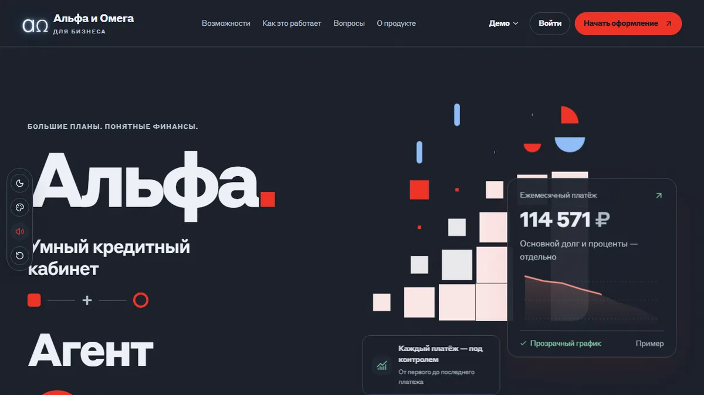
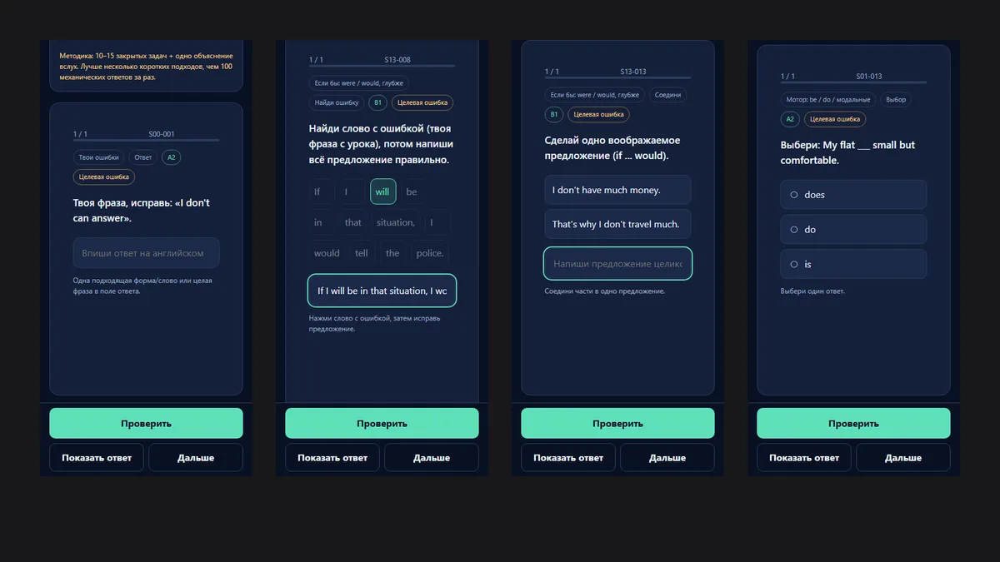
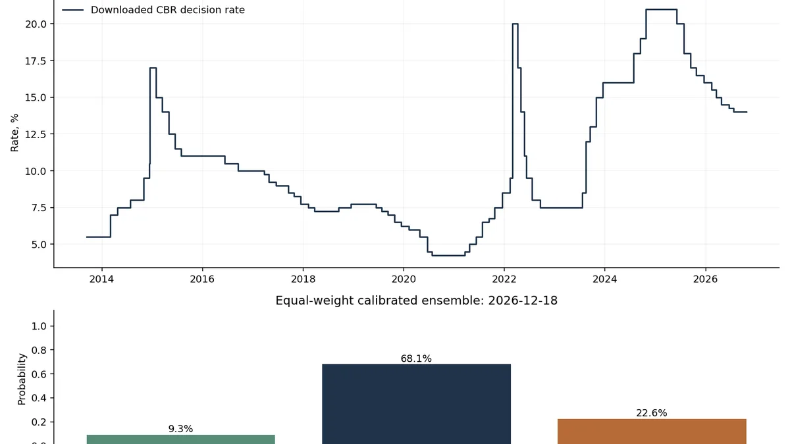
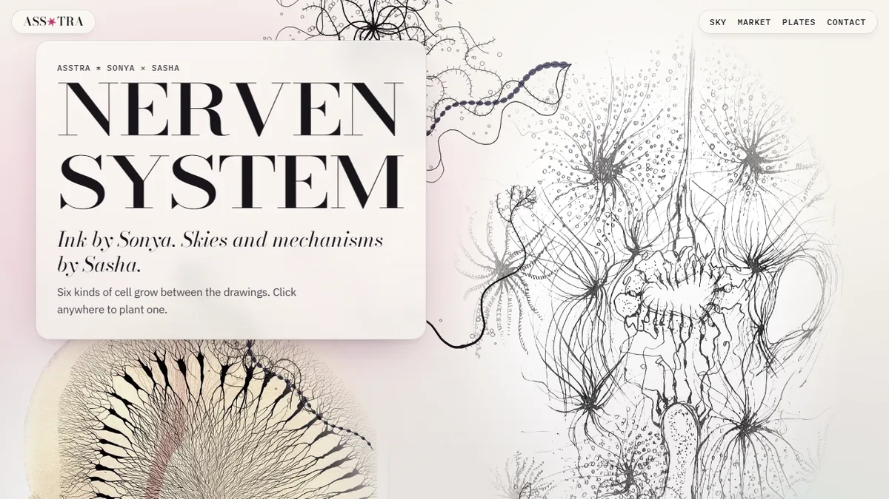

 
a 3D scene rendered in terminal quarter-blocks: it is the spinner of my Claude Code, see <a href="https://github.com/alexregrets/hyperspace">hyperspace</a>

<picture>
  <source media="(prefers-color-scheme: dark)" srcset="assets/terminal-dark.svg">
  
</picture>

I build things at the seam between economics and code. Not an ML engineer who picked up some economics, and not an economist who picked up some Python: the combination is the point, and it is rare because it costs you both halves.

Where it is heading: **mechanism design for economies where the players are AI agents**, and causal inference to check what those agents actually do.

Four shelves below: **product**, **research**, **design**, **play**. Each flagship has a case-study README: the problem, the constraints, the result in numbers, what I would do differently, and my honest role. AI agents write much of my code; the problem framing, the specs, the tests and the acceptance are mine.

 

## ◆ Product

<table>
<tr>
<td width="56%" valign="top">

</td>
<td width="44%" valign="top">

### [Credit agent for small business](https://github.com/alexregrets/alfa-credit-agent)

Bank hackathon, team of five, **I was captain**. Instead of an approval probability the owner sees *"you meet N of M bank conditions"*, the one step that raises the limit, and that limit in roubles. The LLM only reads documents and explains; the numbers come from a rule-based core gated by a golden exam (8/8) and a mutation test of the exam itself.

Didn't make the final. The README says why.

`case study` · [alphahack.ru](https://alphahack.ru)

</td>
</tr>
<tr>
<td width="56%" valign="top">

</td>
<td width="44%" valign="top">

### [Homework trainers](https://github.com/alexregrets/tutor-trainers)

A product with exactly two users: the students I tutor in English. A Telegram courier delivers trainers to their phones and logs every attempt. The log said the bottleneck was **completion, not difficulty** (21 starts, 9 finishes), so that is what the next iteration fixed. Every new format has to cite a learning-science mechanism or it doesn't ship.

`Python` `aiogram` `JS` · spaced repetition · 12 tests in CI

</td>
</tr>
</table>

**Also:** an MCP scenario for an investing-app hackathon (T-Bank, team KAPI), two PRs with 11 new tests in a teammate's private repo · [hh-agent](https://github.com/alexregrets/hh-agent), a job-search agent where the cover-letter variant is assigned by coin flip, so comparing letters is an experiment, not hindsight.

 

## ◆ Research

<table>
<tr>
<td width="44%" valign="top">

### [Lampa](https://github.com/alexregrets/lampa)

Forecasting Bank of Russia rate decisions from public data only: 1 739 primary-source files, each hashed. Walk-forward over 83 meetings: the ensemble beats the market-implied baseline on log loss by **16%** (0.692 vs 0.824, permutation p = 0.003).

Second question: is there an SVB inside Russian banking? I built the score and it **did not validate** (ROC-AUC 0.46). It stays in the README as a negative result.

`Python` `LightGBM` `statsmodels` · CI

</td>
<td width="56%" valign="top">

</td>
</tr>
</table>

| Also in research | |
|---|---|
| [**Econometrics Championship**](https://github.com/alexregrets/econ-championship) | A Cournot tournament: teams play the market, the market leaves a panel behind, and the same students regress on data they generated. Demoed to the course lead. **Next:** LLM agents in the seats. `450+ tests` |
| [**university-analysis**](https://github.com/alexregrets/university-analysis) | 14.5k observations × 27 features. OLS and a difference-in-differences read on the COVID shock to university rankings. |

<b>Inside the tournament</b>

 

Student teams run firms in a shared Cournot market for several rounds. Linear inverse demand `P = a − b·Q`, interior Nash at `q* = (a − c) / b(n+1)`, plus an asymmetric engine for firm-specific costs. Market parameters are inverted from the Russian oil market in 2013, so the numbers have a source.

Mechanics switch on at chosen rounds for chosen teams, which makes treatment timing a design decision rather than something to recover from noise. That is the part I care about.

Everything under `core/` is pure and deterministic, written test-first, because a plausible-but-wrong formula looks exactly like a correct one.

In Cournot the payoff is a formula, so preferences are not the problem: what is left is pure strategy. Put LLM agents in the seats and the question becomes empirical. Do they find Nash, drift into collusion, or settle somewhere stranger?

 

## ◆ Design

<table>
<tr>
<td width="56%" valign="top">

</td>
<td width="44%" valign="top">

### [ASSTRA · Nerven System](https://github.com/alexregrets/asstra)

A generative art drop with a mechanism inside. Ink by Sonya, skies and the growing plates by me. Buyers place sealed bids and **everyone pays one clearing price**, a uniform (k+1)-th price auction that generalises Vickrey, so bidding your true value is the safe move.

`JS` `Python` · 120 + 6 tests · live at [fuaiclub.ru/asstra](https://fuaiclub.ru/asstra)

</td>
</tr>
</table>

**Also:** the design system and landing of the credit agent above (living pattern, light and dark, mobile) · [caviarshow.ru](https://caviarshow.ru), a bilingual landing for the family business, no build step.

 

## ◆ Play

<table>
<tr>
<td width="50%" valign="top">

### [Omega Grand Prix](https://github.com/alexregrets/omega-gp)

A browser racer with no assets: friction-circle tyres, an engine **synthesised from cylinder firing order**, procedural music. It tests itself: a bot drives every car three laps in headless Chrome on each push.

`three.js` `WebAudio`

</td>
<td width="50%" valign="top">

### [hyperspace](https://github.com/alexregrets/hyperspace)

A Claude Code mod: the spinner becomes a space battle. A hand-written 3D rasterizer with a z-buffer, bloom and a cutting camera, drawn in terminal quarter-blocks.

`TypeScript` · `/plugin install hyperspace@hyperspace`

</td>
</tr>
</table>

| Also in play | |
|---|---|
| [**BRAINROT-STRIKE**](https://github.com/valodya02/skill_issue_game) | Browser multiplayer arena shooter built at a vibe-coding hackathon. A streamer voice in your ear gives advice, half of it fatal. 24 of 32 commits are mine. |
| [**claude-brain-starter**](https://github.com/alexregrets/claude-brain-starter) | File-based memory for Claude Code: a 60-line router, one hub per area of life, dated decisions so you stop re-arguing them. |
| [**quiet-transcript**](https://github.com/alexregrets/quiet-transcript) | Desktop app: audio, video and links into clean Markdown notes. `Tauri` `Rust` |

<b>More</b>

 

| Project | What it does | Stack |
|---|---|---|
| [uni_mail_bot](https://github.com/alexregrets/uni_mail_bot) | IMAP poller forwarding a shared university mailbox into Telegram. Live on a VPS | Python · aiogram |
| [sc-linkbot](https://github.com/alexregrets/sc-linkbot) | SoundCloud link in, tagged MP3 out. Queue, rate limits, plugin seam | Python |
| [python-economics](https://github.com/alexregrets/python-economics) | Second-year econometrics: OLS with diagnostics, pandas | Python · statsmodels |
| [learning](https://github.com/alexregrets/learning) | Open log of relearning to program, failures included | HTML |

 

## How I work

**Nothing counts without a run.** Predict the output, run the code, then reconcile the difference. The gap is the part worth studying.

**Accept by a red test, not by a report.** An agent saying "done" is a claim; a test that went red and then green is evidence.

**Negative results stay in.** A score that didn't validate is still a finding, and hiding it would make every other number less credible.

## Now

LLM agents in the Cournot market · a Vickrey auction with LLM bidders · causal inference: IV, DiD, RDD · a master's in Europe, 2028

---

Moscow · [Telegram](https://t.me/alexeval) · sanek2OO6@mail.ru

