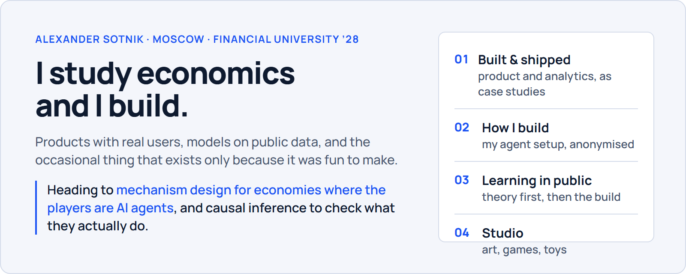
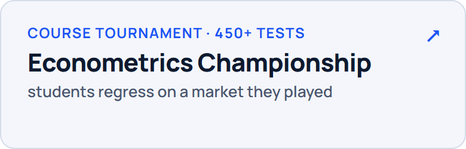
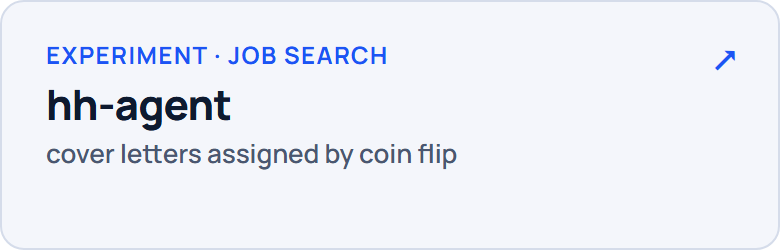
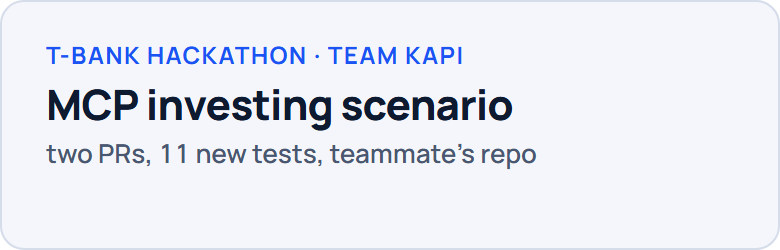
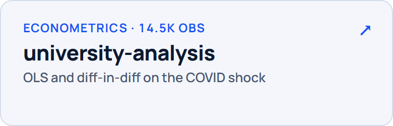
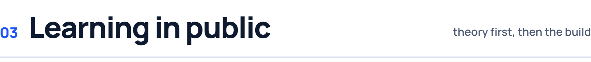
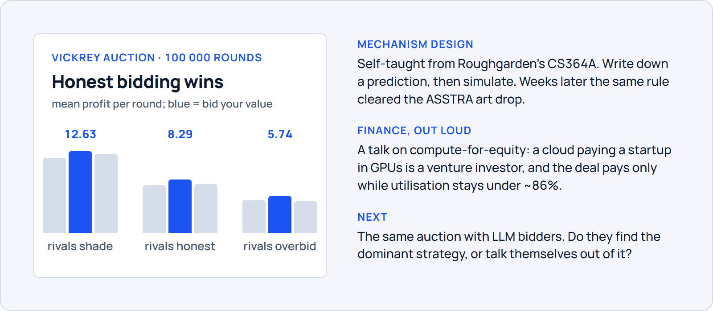
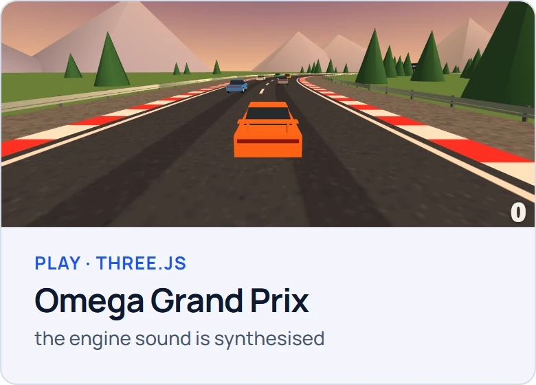
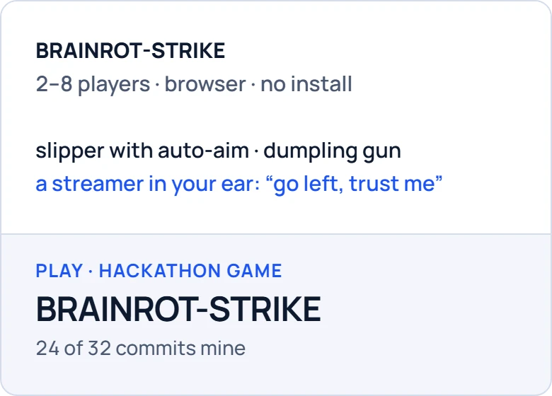

 
a 3D scene rendered in terminal quarter-blocks: it is the spinner of my Claude Code, see <a href="https://github.com/alexregrets/hyperspace">hyperspace</a>

<picture><source media="(prefers-color-scheme: dark)" srcset="assets/shelf/about-dark.png"></picture>

 

<picture>
  <source media="(prefers-color-scheme: dark)" srcset="assets/shelf/v3-h-built-dark.png">
  
</picture>

<a href="https://github.com/alexregrets/alfa-credit-agent"><picture><source media="(prefers-color-scheme: dark)" srcset="assets/shelf/p-alfa-dark.webp"></picture></a>

**[Credit agent for small business](https://github.com/alexregrets/alfa-credit-agent)** · bank hackathon, team of five, I was captain. The LLM reads documents and explains; the numbers come from a rule-based core that has to pass a golden exam, and the exam itself was mutation-tested. Didn't make the final, and the case study says why. Live: [alphahack.ru](https://alphahack.ru)

 

<a href="https://github.com/alexregrets/tutor-trainers"><picture><source media="(prefers-color-scheme: dark)" srcset="assets/shelf/p-trainers-dark.webp"></picture></a>

**[Homework trainers](https://github.com/alexregrets/tutor-trainers)** · a product with exactly two users, the students I tutor in English. A Telegram courier delivers trainers to their phones and logs every attempt; the log said the bottleneck was completion, not difficulty. Every new format must cite a learning-science mechanism or it doesn't ship.

 

<a href="https://github.com/alexregrets/lampa"><picture><source media="(prefers-color-scheme: dark)" srcset="assets/shelf/p-lampa-dark.webp"></picture></a>

**[Lampa](https://github.com/alexregrets/lampa)** · Bank of Russia rate decisions from primary sources only, every file hashed. The second question, whether there is an SVB inside Russian banking, got a score that **did not validate** (ROC-AUC 0.46). It stays in the README: a hidden negative result would make every other number less credible.

<b>Also built</b>

<a href="https://github.com/alexregrets/econ-championship"><picture><source media="(prefers-color-scheme: dark)" srcset="assets/shelf/m-econ-dark.png"></picture></a>
<a href="https://github.com/alexregrets/hh-agent"><picture><source media="(prefers-color-scheme: dark)" srcset="assets/shelf/m-hh-dark.png"></picture></a>

<picture><source media="(prefers-color-scheme: dark)" srcset="assets/shelf/m-kapi-dark.png"></picture>
<a href="https://github.com/alexregrets/university-analysis"><picture><source media="(prefers-color-scheme: dark)" srcset="assets/shelf/m-uni-dark.png"></picture></a>

 

<picture>
  <source media="(prefers-color-scheme: dark)" srcset="assets/shelf/v3-h-how-dark.png">
  
</picture>

<picture>
  <source media="(prefers-color-scheme: dark)" srcset="assets/shelf/v3-pipeline-dark.png">
  
</picture>

Plain Markdown files, a few hooks, three models and one human at the top. AI writes much of my code; the framing, the specs, the tests and the acceptance are mine. A starter version of the memory layer is open: [claude-brain-starter](https://github.com/alexregrets/claude-brain-starter).

**Nothing counts without a run.** Predict the output, run it, then reconcile the difference. **Accept by a red test, not by a report.** An agent saying "done" is a claim; a test that went red and then green is evidence.

 

<picture>
  <source media="(prefers-color-scheme: dark)" srcset="assets/shelf/v3-h-learn-dark.png">
  
</picture>

<a href="https://github.com/alexregrets/asstra"><picture><source media="(prefers-color-scheme: dark)" srcset="assets/shelf/learn-dark.png"></picture></a>

 

<picture>
  <source media="(prefers-color-scheme: dark)" srcset="assets/shelf/v3-h-studio-dark.png">
  
</picture>

<a href="https://github.com/alexregrets/asstra"><picture><source media="(prefers-color-scheme: dark)" srcset="assets/shelf/t-asstra-dark.webp"></picture></a>
<a href="https://github.com/alexregrets/omega-gp"><picture><source media="(prefers-color-scheme: dark)" srcset="assets/shelf/t-omega-dark.webp"></picture></a>

<a href="https://github.com/alexregrets/hyperspace"><picture><source media="(prefers-color-scheme: dark)" srcset="assets/shelf/t-hyperspace-dark.webp"></picture></a>
<a href="https://github.com/valodya02/skill_issue_game"><picture><source media="(prefers-color-scheme: dark)" srcset="assets/shelf/t-brainrot-dark.webp"></picture></a>

 

<picture><source media="(prefers-color-scheme: dark)" srcset="assets/shelf/v3-h-recent-dark.png"></picture>

<!-- recent:start -->
- `2026-11-27` &nbsp; **[quiet-transcribe](https://github.com/alexregrets/quiet-transcribe)** &nbsp; v0.2: vosk, t-one, openai-compat engines, two tracks, lesson folders, Windows recorder, fu
- `2026-11-17` &nbsp; **[groupmate-bot](https://github.com/alexregrets/groupmate-bot)** &nbsp; пинг: не больше 5 заданий, остальное ссылкой на /hw
- `2026-10-19` &nbsp; **[hyperspace](https://github.com/alexregrets/hyperspace)** &nbsp; hyperspace 0.3.0: 3D README, scene clip, previews out of git
- `2026-10-07` &nbsp; **[claude-brain-starter](https://github.com/alexregrets/claude-brain-starter)** &nbsp; claude-brain-starter: router, preferences, open loops, sphere hub, checkpoint template
- `2026-09-12` &nbsp; **[econ-championship](https://github.com/alexregrets/econ-championship)** &nbsp; docs: PRODUCT_REVIEW, CLAUDE.md проекта, DECISIONS 21–29, STATE — ревизия 12.09 закрыта
<!-- recent:end -->

<a href="https://t.me/alexeval"><picture><source media="(prefers-color-scheme: dark)" srcset="assets/shelf/footer-dark.png"></picture></a>
