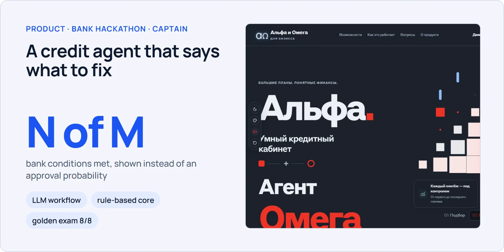
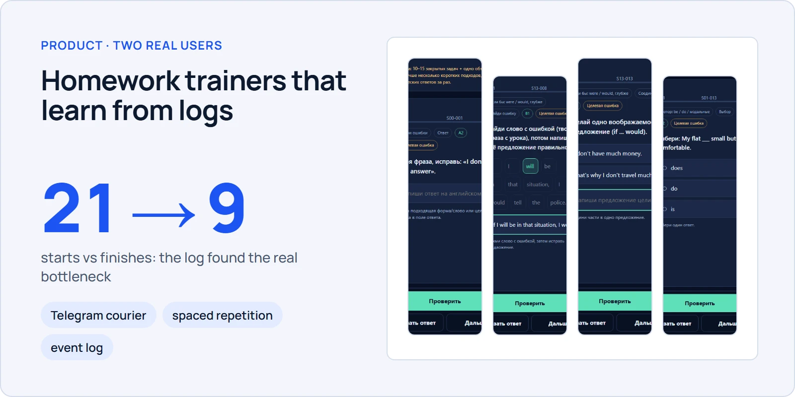
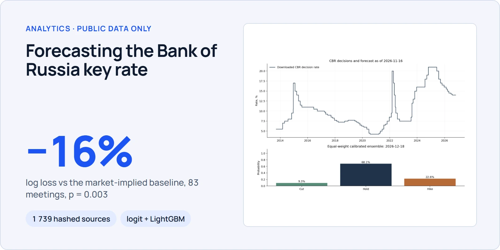
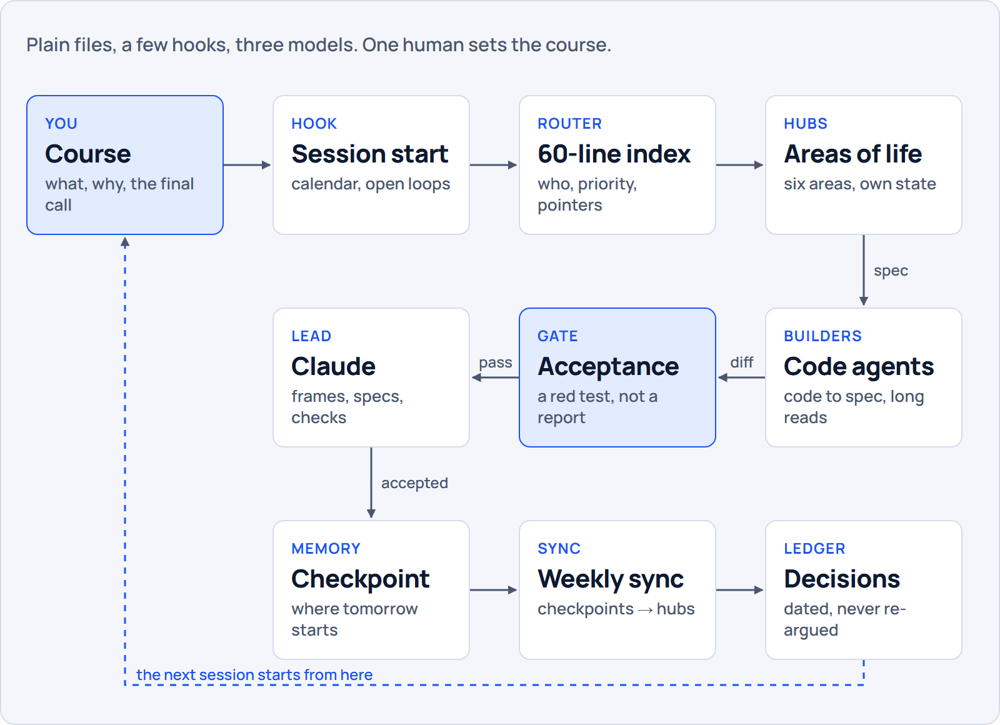
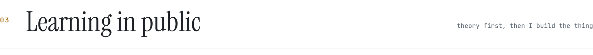
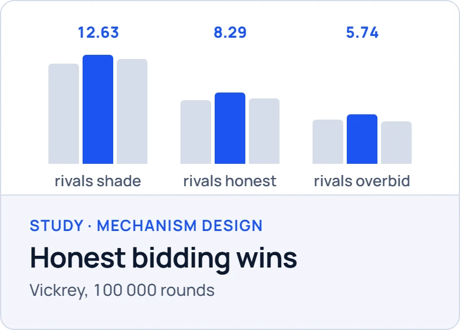
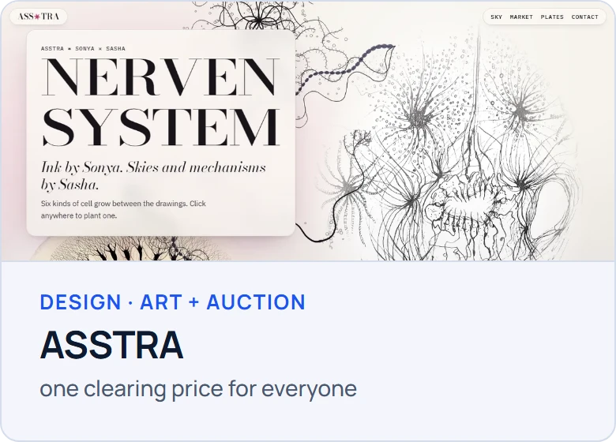
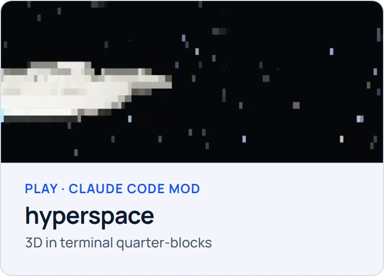

 
a 3D scene rendered in terminal quarter-blocks: it is the spinner of my Claude Code, see <a href="https://github.com/alexregrets/hyperspace">hyperspace</a>

<picture>
  <source media="(prefers-color-scheme: dark)" srcset="assets/terminal-dark.svg">
  
</picture>

I study economics and I build. Products with real users, models on public data, and the occasional thing that exists only because it was fun to make. Where it is heading: **mechanism design for economies where the players are AI agents**, and causal inference to check what those agents actually do.

Each flagship below has a case-study README: the problem, the constraints, the result in numbers, what I would do differently, and my honest role.

 

<picture>
  <source media="(prefers-color-scheme: dark)" srcset="assets/shelf/h-built-dark.png">
  
</picture>

<a href="https://github.com/alexregrets/alfa-credit-agent"><picture><source media="(prefers-color-scheme: dark)" srcset="assets/shelf/p-alfa-dark.webp"></picture></a>

**[Credit agent for small business](https://github.com/alexregrets/alfa-credit-agent)** · bank hackathon, team of five, I was captain. The LLM reads documents and explains; the numbers come from a rule-based core that has to pass a golden exam, and the exam itself was mutation-tested. Didn't make the final, and the case study says why. Live: [alphahack.ru](https://alphahack.ru)

 

<a href="https://github.com/alexregrets/tutor-trainers"><picture><source media="(prefers-color-scheme: dark)" srcset="assets/shelf/p-trainers-dark.webp"></picture></a>

**[Homework trainers](https://github.com/alexregrets/tutor-trainers)** · a product with exactly two users, the students I tutor in English. A Telegram courier delivers trainers to their phones and logs every attempt; the log said the bottleneck was completion, not difficulty. Every new format must cite a learning-science mechanism or it doesn't ship.

 

<a href="https://github.com/alexregrets/lampa"><picture><source media="(prefers-color-scheme: dark)" srcset="assets/shelf/p-lampa-dark.webp"></picture></a>

**[Lampa](https://github.com/alexregrets/lampa)** · Bank of Russia rate decisions from primary sources only, every file hashed. The second question, whether there is an SVB inside Russian banking, got a score that **did not validate** (ROC-AUC 0.46). It stays in the README: a hidden negative result would make every other number less credible.

<b>Also built</b>

 

| project | what it is |
|---|---|
| [**Econometrics Championship**](https://github.com/alexregrets/econ-championship) | A Cournot tournament for a course: teams play the market, the market leaves a panel behind, and the same students regress on data they generated. 450+ tests, `core/` written test-first. Next: LLM agents in the seats. |
| [**hh-agent**](https://github.com/alexregrets/hh-agent) | A job-search agent where the cover-letter variant is assigned by coin flip, so comparing letters is an experiment, not hindsight. |
| **T-Bank hackathon, team KAPI** | An MCP scenario for an investing app, two PRs with 11 new tests in a teammate's private repo. |
| [**university-analysis**](https://github.com/alexregrets/university-analysis) | 14.5k observations × 27 features: OLS and a difference-in-differences read on the COVID shock to university rankings. |

 

<picture>
  <source media="(prefers-color-scheme: dark)" srcset="assets/shelf/h-how-dark.png">
  
</picture>

<picture>
  <source media="(prefers-color-scheme: dark)" srcset="assets/shelf/pipeline-dark.png">
  
</picture>

Plain Markdown files, a few hooks, three models and one human at the top. AI writes much of my code; the framing, the specs, the tests and the acceptance are mine. A starter version of the memory layer is open: [claude-brain-starter](https://github.com/alexregrets/claude-brain-starter).

**Nothing counts without a run.** Predict the output, run it, then reconcile the difference. **Accept by a red test, not by a report.** An agent saying "done" is a claim; a test that went red and then green is evidence.

 

<picture>
  <source media="(prefers-color-scheme: dark)" srcset="assets/shelf/h-learn-dark.png">
  
</picture>

<table>
<tr>
<td width="50%" valign="top"><picture><source media="(prefers-color-scheme: dark)" srcset="assets/shelf/t-vickrey-dark.webp"></picture></td>
<td width="50%" valign="top">

**Mechanism design**, self-taught from Roughgarden's CS364A. The rule: write down a prediction, then simulate. In a second-price auction honest bidding wins whatever the rivals do. Weeks later the same idea shipped as the clearing rule of [ASSTRA](https://github.com/alexregrets/asstra).

**Finance, out loud.** A conference talk on compute-for-equity: a cloud provider paying a startup in GPUs is a venture investor, and the deal pays only while utilisation stays under ~86%. A student research project on macro shocks and the capitalisation of Russian public banks, run through GitHub issues.

**Next:** the same auction with LLM bidders. Do they find the dominant strategy, or talk themselves out of it?

</td>
</tr>
</table>

 

<picture>
  <source media="(prefers-color-scheme: dark)" srcset="assets/shelf/h-studio-dark.png">
  
</picture>

<table>
<tr>
<td width="50%"><a href="https://github.com/alexregrets/asstra"><picture><source media="(prefers-color-scheme: dark)" srcset="assets/shelf/t-asstra-dark.webp"></picture></a></td>
<td width="50%"><a href="https://github.com/alexregrets/omega-gp"><picture><source media="(prefers-color-scheme: dark)" srcset="assets/shelf/t-omega-dark.webp"></picture></a></td>
</tr>
<tr>
<td width="50%"><a href="https://github.com/alexregrets/hyperspace"><picture><source media="(prefers-color-scheme: dark)" srcset="assets/shelf/t-hyperspace-dark.webp"></picture></a></td>
<td width="50%"><a href="https://github.com/valodya02/skill_issue_game"><picture><source media="(prefers-color-scheme: dark)" srcset="assets/shelf/t-brainrot-dark.webp"></picture></a></td>
</tr>
</table>

 

### Recently shipped

<!-- recent:start -->
| when | repo | last commit |
|---|---|---|
| `2026-11-17` | [groupmate-bot](https://github.com/alexregrets/groupmate-bot) | пинг: не больше 5 заданий, остальное ссылкой на /hw |
| `2026-10-19` | [hyperspace](https://github.com/alexregrets/hyperspace) | hyperspace 0.3.0: 3D README, scene clip, previews out of git |
| `2026-10-07` | [claude-brain-starter](https://github.com/alexregrets/claude-brain-starter) | claude-brain-starter: router, preferences, open loops, sphere hub, checkpoint template |
| `2026-09-12` | [econ-championship](https://github.com/alexregrets/econ-championship) | docs: PRODUCT_REVIEW, CLAUDE.md проекта, DECISIONS 21–29, STATE — ревизия 12.09 закрыта |
| `2026-08-14` | [learning](https://github.com/alexregrets/learning) | progress 08-14 block 3: tournament loop, no code of his own |
<!-- recent:end -->

updated daily by a GitHub Action from my public repos

---

Moscow · [Telegram](https://t.me/alexeval) · sanek2OO6@mail.ru

